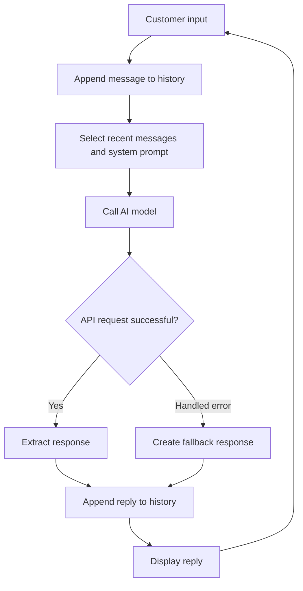

# Day 2 — Prompts, Memory and Python for AI Agents

> AI Agents Workshop | Level 1: Fundamentals | Day 2 of 2

## Overview

Day 2 focuses on controlling AI responses, maintaining conversation history and learning the Python concepts required to build AI agents. The practical project is a customer-support chatbot for **Sweet Crumbs Home Bakery**.

## Learning objectives

- Understand system, user and assistant messages.
- Design effective system prompts and use few-shot examples.
- Extract structured information in JSON format.
- Maintain conversation history and limit the context sent to a model.
- Use dictionaries, functions, type hints, docstrings and decorators.
- Handle common API and JSON parsing errors.

## Topics covered

| No. | Topic | Key concept |
| --- | --- | --- |
| 1 | Messages and roles | System instructions, user input and assistant replies |
| 2 | System prompts | Role, Facts, Rules and Format |
| 3 | Few-shot prompting | Guide responses using example inputs and outputs |
| 4 | JSON output | Convert model responses into structured data |
| 5 | Conversation memory | Append messages and select recent context |
| 6 | Dictionaries and JSON | Store and exchange key-value data |
| 7 | Functions and type hints | Create reusable, documented functions |
| 8 | Decorators | Extend functions with behaviour such as logging |
| 9 | Exception handling | Catch specific errors using `try` and `except` |

## Practical project — Sweet Crumbs AI Chatbot

The chatbot answers questions about the bakery, uses the supplied menu, follows ordering policies and remembers information within its recent conversation context.

### Menu

| Product | Price (INR) |
| --- | ---: |
| Plum cake | 500 |
| Chocolate cake | 650 |
| Cupcake | 80 |

### Main components

- **System prompt:** Defines business facts, response style and rules, including 24 hours' notice for orders, eggless options and no unsupported delivery promises.
- **`get_price()` function:** Calculates the total cost of a product and quantity.
- **`@log_call` decorator:** Records function calls and their results. `functools.wraps()` preserves original function metadata.
- **`history` list:** Stores user messages and assistant replies.
- **`MAX_TURNS = 8`:** Restricts the API request to the latest eight conversation messages plus the system prompt.
- **`try/except`:** Handles rate-limit and connection errors gracefully.
- **Chat loop:** Accepts customer input until `bye`, `exit` or `quit` is entered.

### Workflow



### Key Python examples

```python
# Convert structured data to JSON and back
import json
menu = {"cupcake": 80}
text = json.dumps(menu)
menu = json.loads(text)
```

```python
# Preserve system instructions and select recent messages
recent = [history[0]] + history[1:][-MAX_TURNS:]
```

`MAX_TURNS` counts individual messages, not complete question-answer pairs. This expression limits the context sent to the API without deleting the original history.

### Example interaction (illustrative)

```text
You: Hi, my name is Ravi.
Bot: Hello Ravi! How can I help?
You: I would like two eggless chocolate cakes.
Bot: Two chocolate cakes cost Rs 1,300. Orders need 24 hours' notice.
You: What did I request?
Bot: You requested two eggless chocolate cakes.
You: bye
Bot: Thank you for visiting Sweet Crumbs!
```

## Getting started

### Requirements

- Python 3 or Google Colab
- OpenAI-compatible Python SDK
- API credentials and an appropriately configured client from Day 1
- Access to the workshop model, `openai/gpt-oss-20b`, through the configured provider

### Run the project

1. Open the Day 1 setup notebook or cell in Google Colab.
2. Install the SDK if required (`pip install openai`, or `!pip install openai` in Colab).
3. Configure your API credentials securely and initialize `client` using your Day 1 provider settings.
4. Run the Day 2 chatbot code from the workshop material.
5. Test menu questions, order requests, conversation memory and exit commands.

Never commit API keys to GitHub. Keep credentials in environment variables or Colab Secrets.

## Your 10% — Hands-on exercises

- [ ] Remove and restore prompt rules; compare answers about one-hour delivery.
- [ ] Build a few-shot classifier with three examples and test five new messages.
- [ ] Extract order details (`name`, `item`, `qty`, `date`, `eggless`) as JSON and handle parsing errors.
- [ ] Set `MAX_TURNS = 2` and observe how earlier information becomes unavailable to the model.
- [ ] Adapt the chatbot to your own business using a catalogue dictionary, a system prompt and a documented function.

## Expected learning outcomes

By completing Day 2, learners should understand how to build a contextual chatbot, guide AI responses, process structured data, write reusable Python functions and handle common failures.

## Current limitations

- Conversation memory is limited to recent messages supplied to the model and is not persistent across program restarts.
- The price function is demonstrated separately; the chatbot does not yet call it automatically.
- Prompt instructions do not guarantee accurate responses or valid JSON; outputs require validation.
- Error handling covers selected failures, not every possible exception.

## Next steps — Day 3

Prepare ten customer questions and a business catalogue as a Python dictionary. Day 3 introduces the agent loop and LangChain; Day 4 introduces callable tools.

---

*Source: Day 2 workshop material — Prompts, memory and the Python agents need. This README summarizes the lesson and does not claim that the exercises have already been completed.*
