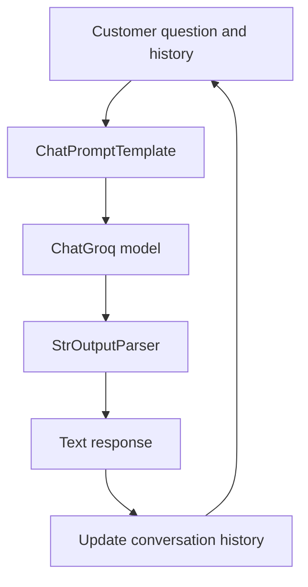
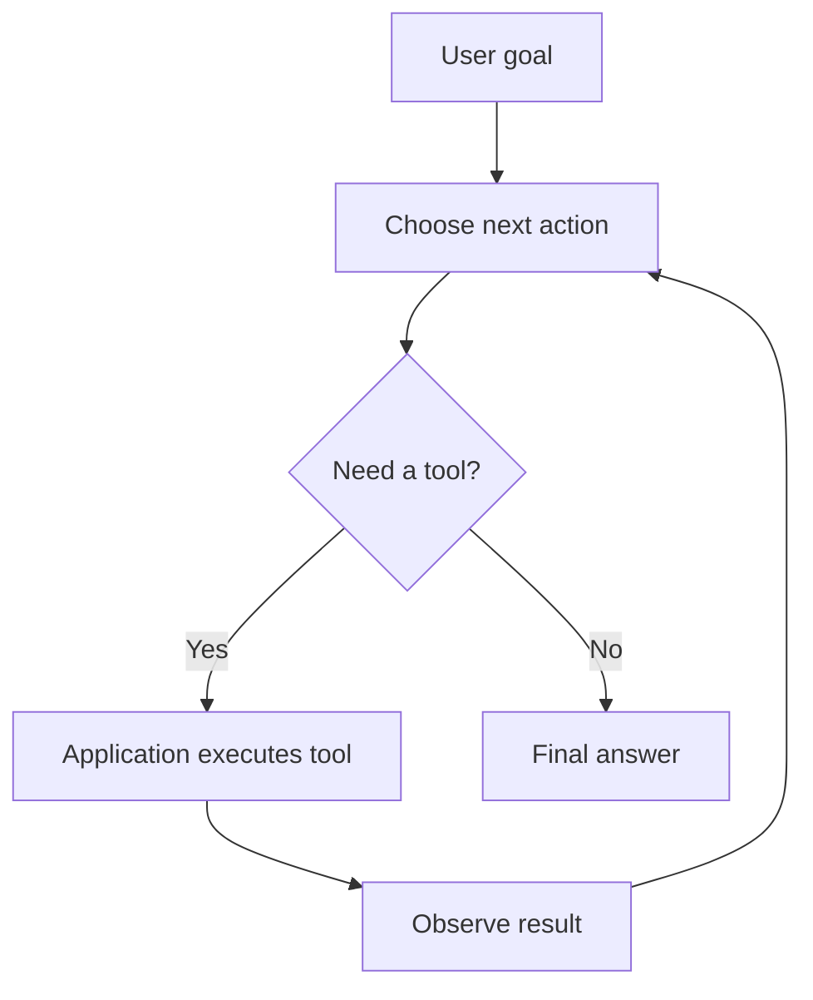

# Day 3 — Your First AI Agent with LangChain

AI Agents Workshop | Level 2 — Single Agent | Sweet Crumbs Home Bakery

## Overview

Day 3 builds on the Day 2 chatbot by introducing agent architecture, LangChain, reusable prompt templates, conversation memory and automated testing. The project recreates the Sweet Crumbs assistant using Groq and LangChain, then initializes an agent without tools as preparation for Day 4.

## Learning objectives

| Topic | Concept |
|---|---|
| 1 | Chatbot vs. agent: answering versus taking actions |
| 2 | Agent components: model, instructions, tools and memory |
| 3 | Agent loop: decide, act, observe and repeat |
| 4 | Traditional software, generative AI and agentic AI |
| 5 | Choosing the simplest suitable approach |
| 6 | LangChain and its common model interface |
| 7 | Chat models, prompt templates, LCEL chains and output parsers |
| 8 | CSV-based testing and pass-rate measurement |

## Technology stack

- Python
- Google Colab
- LangChain and `langchain-groq`
- Groq API — `openai/gpt-oss-20b`
- Python CSV module

## Project structure (suggested)

```text
Day-03/
├── Day_3_AI_Agent.ipynb
├── tests.csv
└── README.md
```

## Getting started

Create a new Google Colab notebook. In the Secrets sidebar, add your Groq API key as `GROQ_API_KEY` and enable notebook access. Never commit your API key to GitHub.

### 1. Install dependencies and configure the model

```python
!pip install -q langchain langchain-groq

import os
from google.colab import userdata
from langchain_groq import ChatGroq

os.environ["GROQ_API_KEY"] = userdata.get("GROQ_API_KEY")
llm = ChatGroq(model="openai/gpt-oss-20b", temperature=0.3)
```

Test the connection:

```python
print(llm.invoke("Hello!").content)
```

### 2. Build the assistant

```python
from langchain_core.prompts import ChatPromptTemplate, MessagesPlaceholder
from langchain_core.output_parsers import StrOutputParser

SYSTEM = """You are the friendly Sweet Crumbs bakery assistant.
Menu: plum cake Rs 500, chocolate cake Rs 650, cupcake Rs 80 each.
Orders require 24 hours' notice. Eggless versions are available.
Do not promise delivery times or locations. For unknown information,
say "I'll check with the owner." Calculate totals carefully.
Reply in under 50 words, in English or Telugu matching the customer."""

prompt = ChatPromptTemplate.from_messages([
    ("system", SYSTEM),
    MessagesPlaceholder("history"),
    ("human", "{question}")
])

chain = prompt | llm | StrOutputParser()
history = []

def ask(question: str) -> str:
    answer = chain.invoke({"history": history, "question": question})
    history.extend([("human", question), ("ai", answer)])
    return answer

print(ask("Hi, I'm Ravi. Do you make eggless cakes?"))
print(ask("What's my name?"))
```

### How the chain works



- `invoke()` executes the chain.
- `MessagesPlaceholder` inserts previous messages into the prompt; the Python list stores them.
- `|` passes each component's output to the next component.
- `StrOutputParser()` extracts response text.
- `history.extend()` appends the question and answer as separate entries.

### 3. Create the test dataset

Run this in a separate Colab cell:

```csv
%%writefile tests.csv
question,must_include
How much is a plum cake?,500
Do you make eggless cakes?,eggless
Can I get a cake today evening?,24 hours
Do you deliver to Kakinada?,check with the owner
What is the price of 6 cupcakes?,480
```

### 4. Run automated tests

```python
import csv

def run_tests(path: str = "tests.csv") -> None:
    with open(path) as file:
        rows = list(csv.DictReader(file))

    if not rows:
        print("No tests found.")
        return

    passed = 0
    for row in rows:
        answer = chain.invoke({
            "history": [],
            "question": row["question"]
        })
        ok = row["must_include"].lower() in answer.lower()
        passed += ok
        print("PASS" if ok else "FAIL", "|", row["question"], "->", answer[:70])

    print(f"\n{passed}/{len(rows)} passed")
    print(f"Pass rate: {passed / len(rows):.0%}")

run_tests()
```

Each test uses empty history to avoid influence from previous questions. The keyword check is case-insensitive. The workshop's initial target is at least four out of five passing tests (80%).

### 5. Create the basic agent

```python
from langchain.agents import create_agent

agent = create_agent(model=llm, tools=[], system_prompt=SYSTEM)
result = agent.invoke({
    "messages": [{"role": "user", "content": "Do you make eggless cakes?"}]
})
print(result["messages"][-1].content)
```

The empty tool list is intentional: Day 3 introduces the agent interface; Day 4 connects callable Python tools. This version cannot actually place or cancel orders.

## Agent loop



A tool-enabled implementation should also enforce a maximum number of rounds. The model requests actions; the application executes authorized tools.

## Your 30% — Practical assignment

- [ ] Customize the system prompt for your own business.
- [ ] Create ten customer questions with expected keywords in `tests.csv`.
- [ ] Run the tests and record the baseline pass rate.
- [ ] Improve one prompt instruction and rerun all tests.
- [ ] Change temperature to 1.0 and run the tests twice; compare results.
- [ ] Classify three business tasks as plain code, one LLM call or agent.
- [ ] Prepare two Python functions with type hints and docstrings for Day 4.

### Experiment results

Record actual results after executing your notebook. No live results are claimed here.

| Experiment | Passed / total | Pass rate |
|---|---|---|
| Baseline (temperature 0.3) | — | — |
| Improved prompt | — | — |
| Temperature 1.0 — run 1 | — | — |
| Temperature 1.0 — run 2 | — | — |

Rebuild the chain after changing the model or prompt.

## Limitations

- Keyword matching is a basic evaluation, not proof of factual correctness.
- Conversation history is stored in memory and is lost when the runtime resets.
- This implementation does not trim conversation history or include the Day 2 exception-handling logic.
- The model may produce inconsistent answers; API availability and package compatibility can affect execution.
- No live tools, order database or persistent memory are connected yet.

## Next step — Day 4

Prepare two business functions, such as a price lookup and an availability check, with clear type hints and docstrings. These will become tools that the agent can request automatically.

## Source

Based on the workshop's Day 3 material, *Your first agent: what an agent is, and LangChain*. Code and explanations are adapted for this repository; the empty-test guard is an additional improvement.
